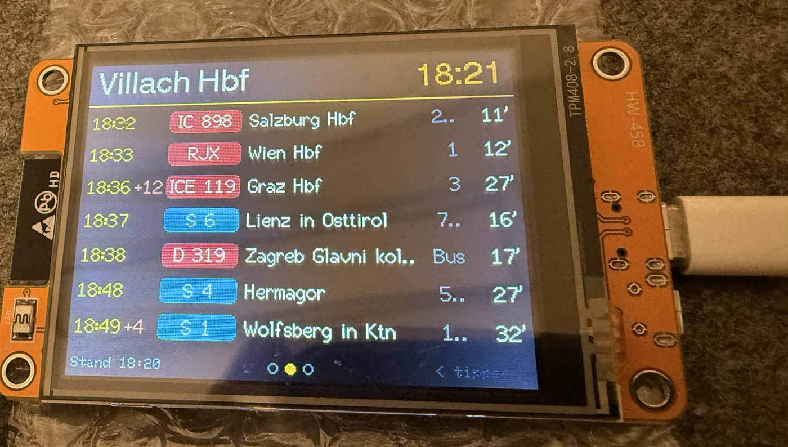

# Grad no!

**Die Abfahrtsanzeige für den Schreibtisch**, damit du den Zug (oder Bus) grad no derwischst.

Eine kleine Abfahrtstafel für Bahn und Bus in Österreich: ein **ESP32 mit 2,8"-Touchdisplay**
(„Cheap Yellow Display“, ca. 15 €) holt die Abfahrten direkt aus der ÖBB-Fahrplanauskunft *Scotty*,
mit Echtzeit-Verspätungen und Ausfällen. Kein Server, kein Home Assistant, keine App nötig:
anstecken, WLAN einrichten, Haltestelle im Browser suchen, fertig.

<!-- Foto vom fertigen Gerät hier einfügen:  -->

> **Hinweis:** Privates Bastelprojekt, **nicht von den ÖBB** und nicht mit ihnen verbunden.
> Es nutzt die öffentlich erreichbaren, aber nicht offiziell dokumentierten Scotty-Schnittstellen.
> Die können sich jederzeit ändern. Bitte sparsam abfragen (Standard: alle 60 s).

## Funktionen

- Bis zu **8 Haltestellen** (Bahnhof oder Bushaltestelle), umschalten durch Tippen aufs Display
- Pro Haltestelle: Filter **Zug / Bus**, **Richtungsfilter**, **Gehzeit** (nicht mehr erreichbare Abfahrten ausblenden)
- Anzeige: Abfahrtszeit, Verspätung, Linie, Ziel, Gleis/Steig, Countdown in Minuten, Ausfälle
- **Weboberfläche** unter `http://grad-no.local` mit Haltestellensuche, Einstellungen und Live-Vorschau
- **Firmware-Update im Browser** (OTA), passwortgeschützt
- WLAN-Einrichtung über einen Hotspot, Nachtmodus (dimmen oder aus)

## Was du brauchst

| Teil | Hinweis | ca. Preis |
|---|---|---|
| ESP32-2432S028R („Cheap Yellow Display“, 2,8", 320×240, resistiver Touch) | AliExpress, Amazon; Standardvariante mit **einer** Micro-USB-Buchse (siehe Fehlersuche für andere) | 12–18 € |
| USB-Kabel mit Datenleitungen | reine Ladekabel funktionieren nicht | – |
| USB-Netzteil 5 V / 1 A | | – |
| Gehäuse (optional) | 3D-Druck, viele CYD-Gehäuse auf Printables/Thingiverse | – |

Löten ist nicht nötig.

## Installation

### Variante 1: Im Browser flashen (am einfachsten)

1. Display per USB an den Computer anschließen.
2. In **Chrome oder Edge** die Installationsseite öffnen: **https://emils1988.github.io/grad-no/**
3. *Installieren* klicken, den Anschluss wählen (Name enthält meist „usbserial“ oder „CH340“), bestätigen.

Klappt die Verbindung nicht: BOOT-Taste gedrückt halten, kurz RST drücken, BOOT loslassen und nochmal versuchen.
Windows braucht eventuell den [CH340-Treiber](https://www.wch-ic.com/downloads/CH341SER_EXE.html).

### Variante 2: Fertige Datei manuell flashen

Unter [Releases](../../releases) liegt `grad-no-komplett-<version>.bin`. Diese mit
[esptool-js](https://espressif.github.io/esptool-js/) auf Adresse **0x0** flashen
(vorher einmal *Erase Flash*).

### Variante 3: Selbst bauen (PlatformIO)

```bash
git clone https://github.com/emils1988/grad-no.git
cd grad-no
pio run -t upload      # bauen und per USB flashen
pio device monitor     # serielle Ausgabe (115200 Baud)
```

## Einrichtung

1. Das Display zeigt **„WLAN einrichten“**. Mit dem Handy ins WLAN **GradNo-Setup** (Passwort `gradno123`).
2. Die Setup-Seite öffnet sich automatisch (sonst `http://192.168.4.1`): eigenes WLAN wählen, Passwort eingeben.
   Optional gleich ein Passwort für die Weboberfläche vergeben.
3. Im Browser **`http://grad-no.local`** öffnen (oder die IP, die am Display steht).
   Anmeldung: Benutzer **`admin`**, Passwort **`gradno`** (oder das selbst vergebene). **Bitte gleich ändern.**
4. Unter *Haltestellen* suchen, hinzufügen, Filter einstellen, **Speichern**.

## Bedienung am Gerät

| Aktion | Wirkung |
|---|---|
| rechts tippen | nächste Haltestelle |
| links tippen | vorige Haltestelle |
| 1,2 s gedrückt halten | Info (IP-Adresse, WLAN, Version) |
| BOOT-Taste kurz / lang | nächste Haltestelle / Info |

## Updates

In der Weboberfläche unter *System → Firmware-Update* die Datei `firmware-<version>-ota.bin`
aus den [Releases](../../releases) hochladen (oder selbst gebaut: `.pio/build/cyd/firmware.bin`).
Die Einstellungen bleiben dabei erhalten.

## Fehlersuche

| Problem | Lösung |
|---|---|
| Display weiß, negativ oder falsche Farben | In der Weboberfläche „Farben invertieren“. Bei CYD-Varianten mit 2 USB-Buchsen in `platformio.ini` `-DILI9341_2_DRIVER=1` durch `-DST7789_DRIVER=1` oder `-DILI9341_DRIVER=1` ersetzen |
| Touch links/rechts vertauscht | „Touch vertauscht“ aktivieren; Kalibrierung über `TOUCH_*` in `src/display.cpp` |
| Keine Abfahrten, Fehlermeldung | *System → Debug: Rohdaten* zeigt die letzte Anfrage und die Antwort von Scotty, beim Melden eines Fehlers bitte mitschicken |
| `grad-no.local` geht nicht | IP-Adresse verwenden (am Display lange drücken) |
| Anderes WLAN | *System → WLAN zurücksetzen*, danach startet der Setup-Hotspot |
| Passwort vergessen | Mit esptool-js *Erase Flash* und neu flashen |

## Aufbau des Codes

| Datei | Inhalt |
|---|---|
| `src/hafas.cpp` | Scotty-Abfragen (Abfahrtstafel `stboard.exe`, Suche `ajax-getstop.exe`), Parsing, Umlaute |
| `src/display.cpp` | Darstellung (TFT_eSPI), Touch (XPT2046), Hintergrundbeleuchtung |
| `src/web.cpp`, `src/webpage.h` | Webserver, JSON-API, OTA-Upload, Weboberfläche |
| `src/main.cpp` | WLAN, Zeit, Abruf-Task, Bedienung, Nachtmodus |
| `src/config.*` | Einstellungen (im NVS-Flash gespeichert) |
| `web/` | Installationsseite für GitHub Pages (ESP Web Tools) |

JSON-API (Basic Auth): `GET/POST /api/config`, `GET /api/search?q=`, `GET /api/board?i=`, `POST /api/show?i=`,
`POST /api/refresh`, `GET /api/status`, `GET /api/raw`, `POST /update`.

## Mitmachen

Ideen, Fehlerberichte und Pull Requests sind willkommen, siehe [CONTRIBUTING.md](CONTRIBUTING.md).
Besonders gesucht: Tests mit anderen Display-Varianten, Gehäuse-Designs, weitere Verkehrsverbünde.

## Lizenz und Danksagung

Dieses Projekt steht unter der [MIT-Lizenz](LICENSE).

Verwendete Bibliotheken: [TFT_eSPI](https://github.com/Bodmer/TFT_eSPI) (Bodmer),
[XPT2046_Touchscreen](https://github.com/PaulStoffregen/XPT2046_Touchscreen) (Paul Stoffregen),
[WiFiManager](https://github.com/tzapu/WiFiManager) (tzapu),
[ArduinoJson](https://arduinojson.org) (Benoît Blanchon),
[ESP Web Tools](https://esphome.github.io/esp-web-tools/) (ESPHome). Es gelten deren jeweilige Lizenzen.
Fahrplandaten: ÖBB Scotty.
