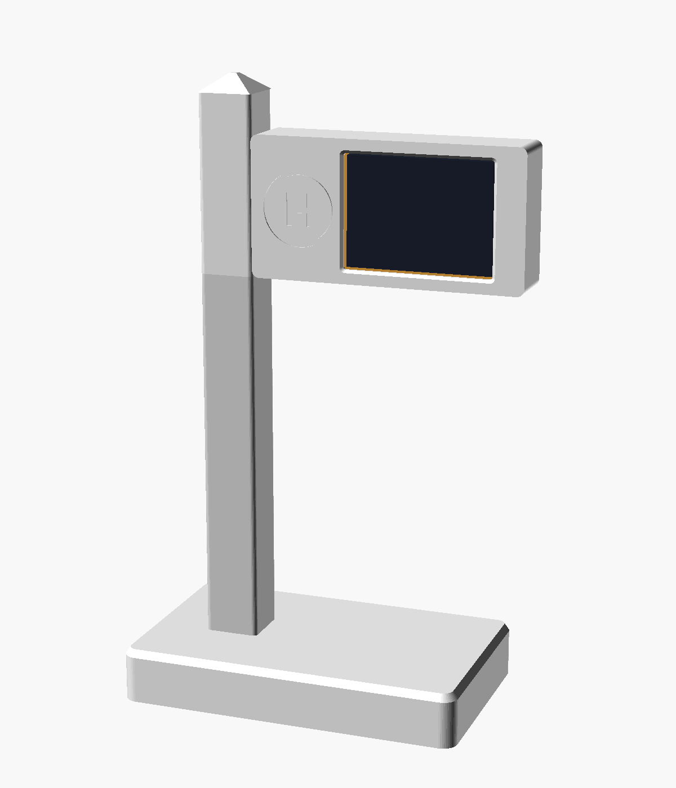
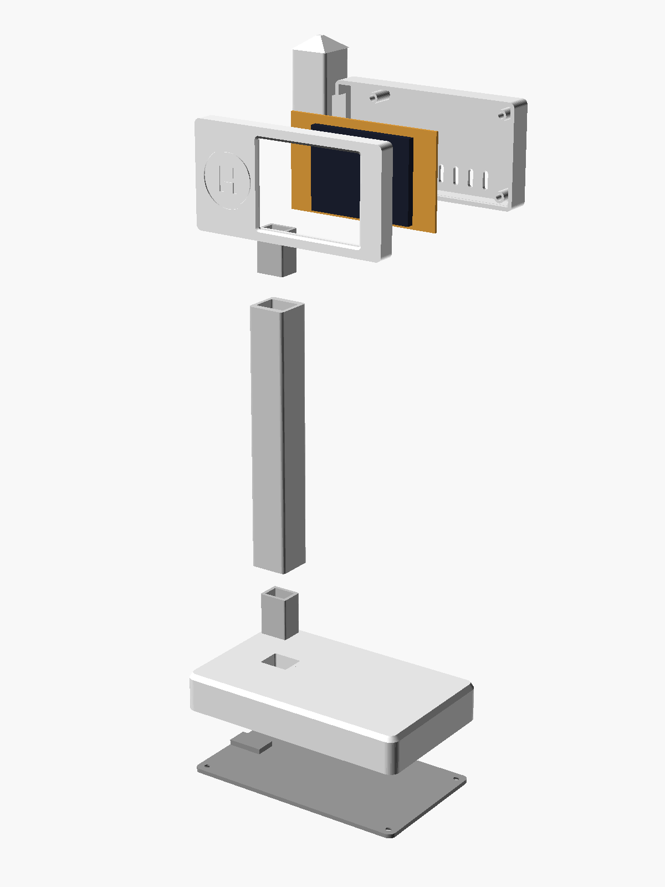

# Halterung „Haltestellen-Mast“

Ein Gehäuse zum 3D-Drucken für Grad no!: Das Display hängt wie ein Haltestellenschild seitlich am Mast.
Das USB-Kabel läuft unsichtbar durch den hohlen Mast in den Sockel, die Buchse schaut seitlich heraus.

<p align="center">
  
  
</p>

> **Erster Entwurf, noch nicht probegedruckt.** Die Board-Maße stammen aus dem Datenblatt bzw. von Fotos.
> Bitte zuerst die **Passtest-Platte** drucken (ca. 10 Minuten) und am eigenen Board prüfen.

**Maße:** ca. 140 × 85 mm Grundfläche, 250 mm hoch (Display-Mitte auf ca. 200 mm).

## Teile

| Datei | Anzahl | Ausrichtung beim Druck | Hinweis |
|---|---|---|---|
| `stl/passtest.stl` | 1 | flach | zuerst drucken, Board auflegen: Fenster und Löcher müssen passen |
| `stl/rahmen.stl` | 1 | Front nach unten | mit „H“-Haltestellensymbol |
| `stl/rueckteil.stl` | 1 | Rückseite nach unten | Rückschale mit Mastkopf in einem Stück |
| `stl/mast.stl` | 1 | liegend | 150 mm, mit Kabelkanal |
| `stl/verbinder.stl` | 2 | stehend | Steckverbinder Mast ↔ Kopf und Mast ↔ Sockel |
| `stl/sockel.stl` | 1 | Oberseite nach unten | mit Aufnahme für die USB-Buchse |
| `stl/boden.stl` | 1 | flach | Bodenplatte |

Kein Stützmaterial nötig. Empfehlung: PLA oder PETG, 0,2 mm Schichthöhe, 3 Wände, 15–20 % Infill.
Der Rahmen sieht mit einem anderen Farbton für das „H“ (Farbwechsel nach 0,6 mm) besonders gut aus.

## Zubehör

| Teil | Menge |
|---|---|
| USB-Verlängerung **USB-C-Einbaubuchse → Stecker passend zum Board, 90° gewinkelt**, ca. 30 cm | 1 |
| Schraube M3 × 16 (Zylinderkopf) – Rückteil → Platine → Rahmen | 4 |
| Schraube M3 × 8 (Senkkopf) – Bodenplatte | 4 |
| Gummifüße Ø 10 mm (optional) | 4 |
| Ballast für den Sockel, z.B. Muttern oder Unterlegscheiben (optional) | – |

Die Schrauben schneiden ihr Gewinde selbst in den Kunststoff, nicht zu fest anziehen.

**Zum Kabel:** Der Stecker muss durch den Kabelkanal passen (13 × 9,5 mm). Er sollte so gewinkelt sein, dass das Kabel
parallel zur Platine abgeht. Das Buchsengehäuse wird im Sockel eingeklemmt, Standardmaß 13 × 8,5 × 22 mm.
Bei anderen Maßen in der `.scad`-Datei `buchse_b`, `buchse_h`, `buchse_l` anpassen.

## Zusammenbau

1. In der Weboberfläche unter *Anzeige → Ausrichtung* **„Querformat gedreht (USB links)“** wählen.
   Im Gehäuse liegt die USB-Buchse auf der Mastseite.
2. Kabel von unten durch Sockel, Verbinder, Mast, Verbinder und Mastkopf fädeln, bis der Stecker im Schild herauskommt.
3. Verbinder in Sockel und Mastkopf stecken, Mast aufstecken. Wenn es wackelt, mit etwas Sekundenkleber fixieren.
4. Buchsengehäuse in die Tasche im Sockel legen, Bodenplatte aufschrauben. Der Steg auf der Platte hält die Buchse.
5. Stecker ins Board stecken, Board mit dem Display nach vorne in den Rahmen legen.
6. Rückteil aufsetzen und mit 4 × M3 × 16 durch die Platinenlöcher in den Rahmen schrauben.

## Anpassen

Alle Maße sind in `grad-no-halterung.scad` oben als Variablen zusammengefasst und lassen sich in
[OpenSCAD](https://openscad.org) ändern, auch über den *Customizer*. Die wichtigsten:

| Variable | Bedeutung | Standard |
|---|---|---|
| `loch_rand` | Mitte der Befestigungslöcher vom Platinenrand | 4,0 |
| `bild_links`, `bild_unten` | Lage des sichtbaren Bildbereichs (USB rechts gemessen) | 10,4 / 3,4 |
| `lcd_d` | Höhe des Displays über der Platine | 4,0 |
| `hinten_frei` | Platz hinter der Platine | 12,2 |
| `mast_l` | Länge des Mastes | 150 |
| `h_symbol` | „H“-Symbol auf dem Rahmen | true |

Einzelnes Teil exportieren:

```bash
openscad -o stl/rahmen.stl -D 'teil="rahmen"' grad-no-halterung.scad
```

Teile: `rahmen`, `rueckteil`, `mast`, `verbinder`, `sockel`, `boden`, `passtest`, Vorschau: `zusammenbau`.
