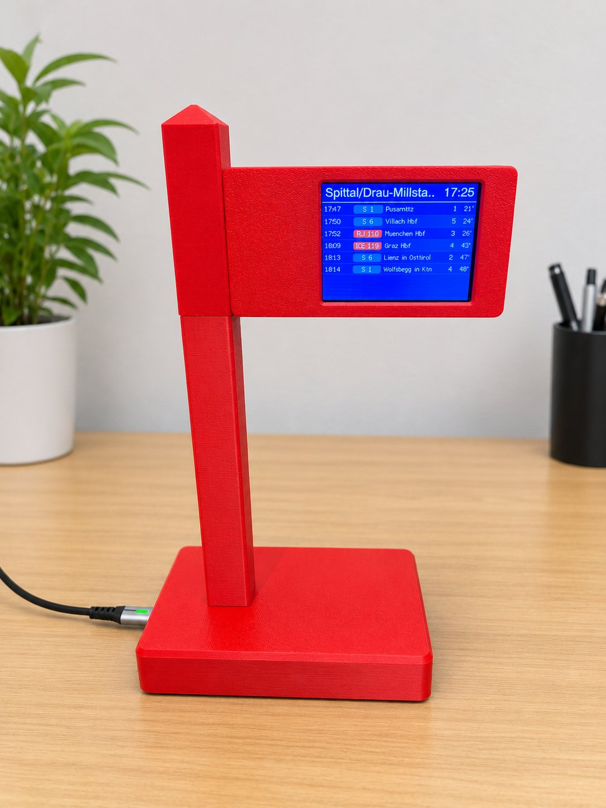
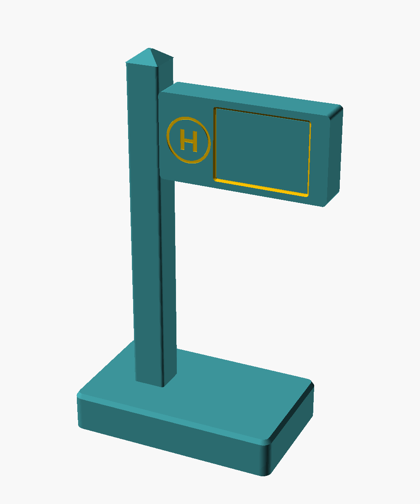

# Halterung „Haltestellen-Mast“

Ein Gehäuse zum 3D-Drucken für Grad no!: Das Display hängt wie ein Haltestellenschild seitlich am Mast.
Das USB-Kabel läuft unsichtbar durch den hohlen Mast in den Sockel, die Buchse sitzt seitlich im Sockel.

<p align="center">
  
  
</p>

Gedruckt und getestet, ohne Stützmaterial.

**Maße:** ca. 140 × 85 mm Grundfläche, 255 mm hoch.

## Teile

| Datei | Anzahl | Ausrichtung beim Druck | Hinweis |
|---|---|---|---|
| `stl/rahmen.stl` | 1 | Front nach unten | „H“-Haltestellensymbol vertieft (einfarbig) |
| `stl/rahmen_ohne_h.stl` | (1) | Front nach unten | statt `rahmen.stl`: glatte Front ohne „H“ |
| `rahmen-2farbig.3mf` | (1) | Front nach unten | statt `rahmen.stl`: Rahmen + „H“-Einlage als zwei Teile für den 2-Farben-Druck |
| `stl/rueckteil.stl` | 1 | Rückseite nach unten | Rückschale mit Mastkopf in einem Stück |
| `stl/mast.stl` | 1 | liegend | 150 mm, mit Kabelkanal |
| `stl/verbinder.stl` | 2 | stehend | Steckverbinder Mast ↔ Kopf und Mast ↔ Sockel (die Datei enthält beide) |
| `stl/sockel.stl` | 1 | Oberseite nach unten | mit Tasche für die USB-Buchse |
| `stl/boden.stl` | 1 | flach | Bodenplatte, der Steg drückt die Buchse in die Tasche |
| `stl/passtest.stl` | – | flach | optional: dünne Platte, prüft Displayfenster und Schraublöcher am eigenen Board |
| `stl/buchsen_test.stl` + `stl/boden_test.stl` | – | wie Sockel / Boden | optional: nur die Sockel-Ecke mit der USB-Tasche, zum Prüfen einer anderen Buchse |

Empfehlung: PLA oder PETG, 0,2 mm Schichthöhe, 3 Wände, 15–20 % Infill.

**2-Farben-Druck des „H“:** `rahmen-2farbig.3mf` im Slicer öffnen. Bambu Studio, OrcaSlicer und PrusaSlicer fragen,
ob die Teile als *ein Objekt mit mehreren Teilen* geladen werden sollen, hier **Ja** wählen. Dann dem Teil „H-Einlage“
die zweite Farbe zuweisen. Die Einlage ist 0,8 mm dick (4 Schichten) und liegt auf dem Druckbett, das „H“ ist also
die Sichtseite. Einzeln gibt es die Teile auch als `stl/rahmen_2farbig.stl` und `stl/h_einlage.stl` (gleiche Koordinaten).
Ohne Mehrfarbdrucker: `rahmen.stl` drucken und bei 0,8 mm (vor der 5. Schicht) das Filament wechseln. Die Front hat dann Farbe 1, und im vertieften „H“ sieht man Farbe 2.

## Zubehör

| Teil | Menge |
|---|---|
| USB-Verlängerung **Stecker → USB-C-Buchse**, 0,5 m, gerader Stecker passend zum Board (getestet mit USB-C: Stouchi USB-C-Verlängerungskabel 50 cm) | 1 |
| Schraube M3 × 16 (Zylinderkopf): Rückteil → Platine → Rahmen | 4 |
| Schraube M3 × 8 (Senkkopf): Bodenplatte | 4 |
| Gummifüße Ø 10 mm (optional) | 4 |
| Ballast für den Sockel, z.B. Muttern oder Unterlegscheiben (optional) | – |

Die Schrauben schneiden ihr Gewinde selbst in den Kunststoff, nicht zu fest anziehen.

**Zum Kabel:** Der Stecker muss durch den Kabelkanal im Mast passen (13 × 9,5 mm). Die Tasche im Sockel ist für ein
Buchsengehäuse von **19,15 × 11,0 × 6,0 mm** ausgelegt. Bei einem anderen Kabel die Buchse messen und in der `.scad`-Datei
`buchse_l`, `buchse_b` und `buchse_h_ist` anpassen, dann am besten zuerst `buchsen_test` + `boden_test` drucken.

## Zusammenbau

1. In der Weboberfläche unter *Anzeige → Ausrichtung* **„Querformat gedreht (USB links)“** wählen.
   Im Gehäuse liegt die USB-Buchse des Boards auf der Mastseite.
2. Kabel mit dem Stecker voran von unten durch Sockel, Verbinder, Mast, Verbinder und Mastkopf fädeln, bis der Stecker im Schild herauskommt.
3. Verbinder in Sockel und Mastkopf stecken, Mast aufstecken. Die Verbinder sitzen stramm. Wenn es trotzdem wackelt, mit etwas Sekundenkleber fixieren.
4. Buchse von unten in die Tasche im Sockel legen. Das Kabel samt Knickschutz liegt dabei im Schlitz hinter der Tasche und läuft unter dem Mastblock in den Kabelkanal.
   Die Tasche ist innen 1 mm in die Seitenwand eingelassen, so sitzt die Buchse fest und der Stecker kommt ganz hinein.
5. Bodenplatte aufschrauben. Der Steg auf der Platte drückt die Buchse nach oben gegen die Taschendecke.
6. Stecker ins Board stecken, Board mit dem Display nach vorne in den Rahmen legen.
7. Rückteil aufsetzen und mit 4 × M3 × 16 durch die Platinenlöcher in den Rahmen schrauben.

## Anpassen

Alle Maße sind in `grad-no-halterung.scad` oben als Variablen zusammengefasst und lassen sich in
[OpenSCAD](https://openscad.org) ändern, auch über den *Customizer*. Die wichtigsten:

| Variable | Bedeutung | Standard |
|---|---|---|
| `loch_rand` | Mitte der Befestigungslöcher vom Platinenrand | 4,0 |
| `bild_links`, `bild_unten` | Lage des sichtbaren Bildbereichs (USB rechts gemessen) | 10,4 / 3,4 |
| `lcd_d` | Höhe des Displays über der Platine | 4,0 |
| `mast_l` | Länge des Mastes | 150 |
| `passung` | Spiel der Steckbuchsen in Mastkopf, Mast und Sockel | 0,3 |
| `steck_spiel` | Luft zwischen Verbinder und Buchse (kleiner = strammer) | 0,05 |
| `buchse_l`, `buchse_b`, `buchse_h_ist` | Tasche für die USB-Buchse | 19,25 / 11,2 / 6,0 |
| `h_modus` | „H“-Symbol: 0 = ohne, 1 = vertieft, 2 = für 2-Farben-Druck | 1 |

Einzelnes Teil exportieren:

```bash
openscad -o stl/rahmen.stl -D 'teil="rahmen"' grad-no-halterung.scad
```

Teile: `rahmen`, `rahmen_ohne_h`, `rahmen_2farbig`, `h_einlage`, `rueckteil`, `mast`, `verbinder`, `sockel`, `boden`,
`buchsen_test`, `boden_test`, `passtest`, Vorschau: `zusammenbau`.
